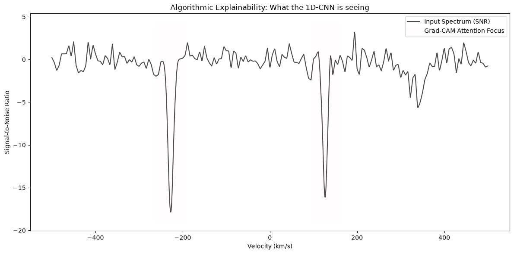
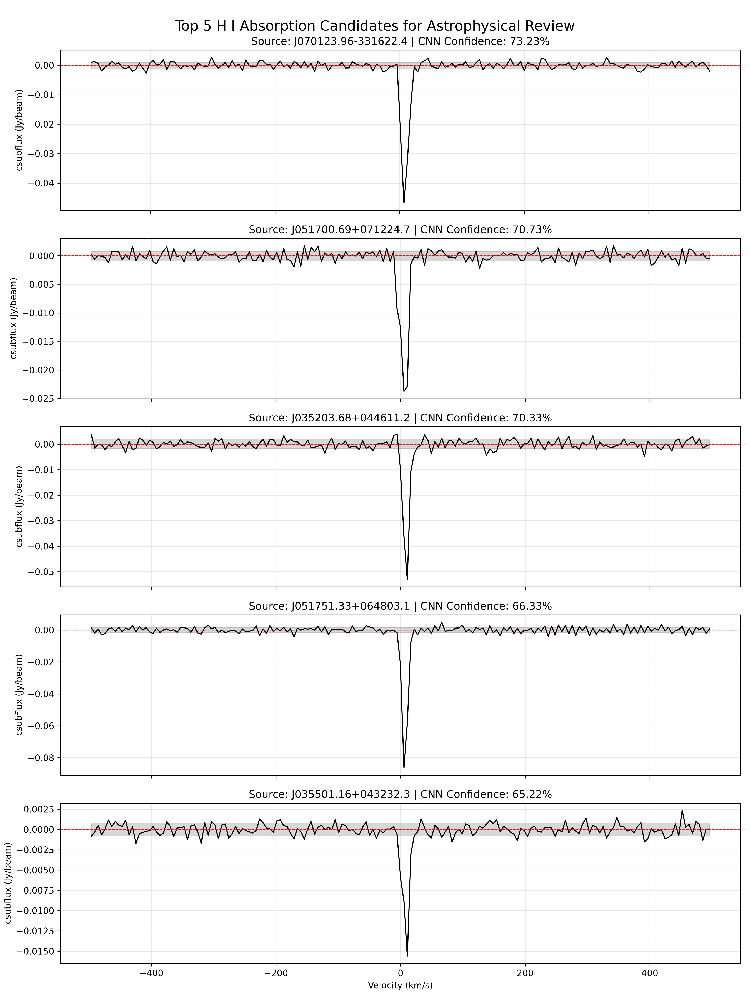
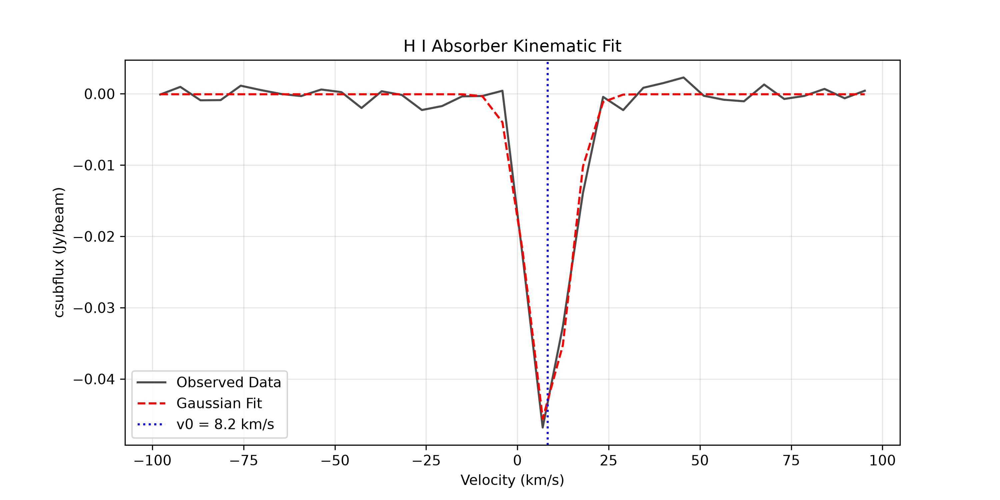

# H-I-Auto-Hunt: Automated 21-cm H I Absorption Hunt with a 1D-CNN

A deep-learning pipeline that searches MeerKAT radio spectra for 21-cm neutral-hydrogen (H I) absorption lines. It uses a dilated 1D residual network trained on synthetic absorption lines injected into empirical survey baselines. All the work is in [`main.ipynb`](main.ipynb).

---

## Abstract

21-cm H I absorption against bright background radio sources traces cold neutral gas, the fuel for star formation, without depending on the luminosity of the absorbing galaxy. Wide-field surveys with SKA precursors (MeerKAT MALS, ASKAP FLASH) now produce too many sightlines for visual inspection. Their spectra also suffer from radio-frequency interference (RFI) and bandpass ripples that defeat simple thresholding.

This project builds an automated detector for such lines:

- **Data:** continuum-subtracted 1-D spectra from the MeerKAT Absorption Line Survey Data Release 3 (MALS DR3), converted to signal-to-noise (S/N) units.
- **Training set:** synthetic multi-component Gaussian absorption profiles injected into empirical survey baselines, which addresses the extreme class imbalance.
- **Model:** a dilated 1D ResNet trained with focal loss.
- **Explainability:** the decisions are inspected with 1D Grad-CAM.

The trained model is then applied to real MALS sightlines, and its top-ranked candidates are fitted for kinematics, column density and an illustrative H I mass density.

## Motivation

Tracing cold neutral gas across cosmic time is central to understanding the star-formation history of the Universe. H I emission is too faint to detect beyond the local Universe, but 21-cm absorption can be detected at high redshift.

Next-generation surveys produce hundreds of thousands of sightlines, and absorbers appear in only a small fraction of them. Telling real absorption from instrumental artefacts at that scale needs an automated, context-aware method rather than manual inspection.

## Aim

To engineer a robust, scalable and interpretable deep-learning architecture that isolates sparse, variable-width spectral features in large datasets dominated by instrumental noise and severe class imbalance.

## Objectives

### Technical objectives
1. **Robust 1D data pipeline:** ingest raw spectra, handle flagged channels, normalise baselines, and convert to S/N or optical-depth (τ) space.
2. **Physical injection engine:** generate realistic multi-component absorption profiles and inject them into empirical noise baselines.
3. **Specialised 1D-CNN:** a dilated 1D ResNet whose receptive field covers both narrow cold-gas lines (~1–5 km/s) and broad warm-gas lines (>30 km/s).
4. **Imbalance-aware loss:** focal loss to emphasise rare, weak absorption signals.
5. **Explainability:** 1D Grad-CAM, to check that the network attends to the absorption dip and not to artefacts.

### Astrophysical objectives
1. **Accelerate blind survey discovery** of rare intervening 21-cm H I absorbers in ASKAP FLASH and MeerKAT MALS.
2. **Trace the cosmic evolution of cold gas:** measure the cosmological H I mass density Ω_HI at 0.4 < z < 1.0.
3. **Characterise absorber kinematics:** velocity widths and temperature phase (Cold vs Warm Neutral Medium, CNM vs WNM).
4. **Eliminate the human bottleneck:** reach a false-alarm rate (FAR) acceptable for survey-scale deployment (target < 0.1 false positives per MHz).

---

## Data

- **Survey:** MeerKAT Absorption Line Survey (MALS) Data Release 3, `malsdr3v1` (Gupta et al. 2025, A&A 698, A120).
- **Spectral window:** `LSPW_10`, the Galactic H I 21-cm window. It covers about −500 to +500 km/s (LSRK) in channels of about 5.5 km/s.
- **Columns:** each spectrum has `Velocity(km/s)`, `csubflux(Jy/b)` (continuum-subtracted flux density) and `error(Jy/b)` (1σ per channel).
- **Source list:** `catalogue_malsdr3v1_all.csv`, the MALS DR3 continuum source catalogue.
- **Access:** per-pointing archives from the MALS portal:
  ```
  https://mals.iucaa.in/osdf/malsdr3v1/{pointing_name}/{spw_id}/spectra.tgz?file_type=SPECTRAL
  ```

**The spectra are not redistributed in this repository.** The two scripts below regenerate them from the public MALS portal. 334 pointing archives were downloaded, and 16,139 spectra were extracted.

## Methodology

| Step | Where | What it does |
|---|---|---|
| 1. Download | [`data_extraction.py`](data_extraction.py) | Filters the catalogue to `LSPW_10` and downloads one `spectra.tgz` per pointing |
| 2. Extract | [`data_unzipping.py`](data_unzipping.py) | Unpacks each archive into `mals_spectra_extracted_lspw_10/<pointing>_LSPW_10/<source>/` |
| 3. Index | `main.ipynb` | Links each `*_spec_selcols.csv` spectrum to its catalogue row, giving `master_dataset_filepaths.csv` |
| 4. Preprocess | `main.ipynb` | Masks non-finite or zero-error channels, converts to S/N = csubflux / error, and resamples to 1,024 channels |
| 5. Inject | `main.ipynb` | Injects 1–3 Gaussian components (probabilities 0.7 / 0.2 / 0.1) with σ_v ~ U(2, 30) km/s and peak S/N ~ U(3.5, 20), placed in the central 70 % of the band. Injection is on the fly with p = 0.5 |
| 6. Model | `main.ipynb` | Dilated 1D ResNet: a 7-tap stem with 32 channels, then 4 residual blocks (dilation 1/2/4/8, 64→128 channels), global average pooling and a linear output |
| 7. Train | `main.ipynb` | Focal loss (α = 0.8, γ = 2), Adam (lr 1e-4, weight decay 1e-5), batch 32, 5 epochs |
| 8. Explain | `main.ipynb` | 1D Grad-CAM on the last dilated convolution |
| 9. Apply | `main.ipynb` | Scores every indexed sightline, ranks the candidates, and inspects the top 5 |
| 10. Physics | `main.ipynb` | Gaussian kinematic fit, column density N_HI = 1.823×10¹⁸ T_s ∫τ dv, and an illustrative Ω_HI |

## Results

**Training** (synthetic injections into the 1,072 indexed baselines): training accuracy rose from 0.899 to 0.981 over 5 epochs.

**Explainability.** In this Grad-CAM run, the attention falls on the two injected dips at about −225 and +125 km/s.



**Application to 1,072 MALS sightlines** ([`blind_discovery_candidates.csv`](blind_discovery_candidates.csv)):
- No sightline scores above p = 0.90.
- The top 5 score between 0.65 and 0.73. All five show a narrow absorption line near v ≈ 0 km/s, i.e. Galactic H I.



**Kinematics of the top candidate, J070123.96−331622.4:**

| Parameter | Value |
|---|---|
| v₀ | 8.24 km/s |
| σ_v | 5.55 km/s |
| FWHM | 13.06 km/s |
| ΔS_peak | −0.0468 Jy/beam |

A line this narrow at near-zero velocity is consistent with Milky Way cold neutral gas.



**Column densities and illustrative Ω_HI.** These assume T_s = 100 K, covering factor 1, an *assumed* continuum flux of 1 Jy, and an *assumed* absorption path ΔX = 15:
- N_HI ranges from 4.2×10¹⁹ to 2.1×10²⁰ cm⁻² across the five candidates.
- Ω_HI ≈ 7.9×10⁻¹¹ for this subset.

**Higher redshift.** A search for 0.4 < z < 1.0 coverage (710–1014 MHz) in the DR3 catalogue finds no pointings. DR3 provides L-band only.

## Limitations and ongoing work

This is a first end-to-end prototype. The points below bound how the results above should be read:

- **Redshift coverage.** The MALS DR3 `LSPW_10` spectra cover only z ≈ 0. Every detection here is Milky Way absorption, not an intervening galaxy.
  - Astrophysical objectives 1 and 2 at 0.4 < z < 1 need UHF or wide-band spectra.
  - The ASKAP FLASH pilot surveys (public on CASDA, project AS109) are the planned next data set.
- **Sample size.** The index used here covers 1,072 of the 16,139 extracted spectra.
- **No held-out split.** The baselines were not filtered against the MALS H I absorption catalogue (GALHICAT), so some contain real absorption. The model was then applied to the same 1,072 sightlines it was trained on.
  - A pointing-wise train/validation/test split and label-filtered baselines are the next step.
- **Comparison with GALHICAT.**
  - **Top 5:** all five candidates are already catalogued. Four are visually confirmed absorbers; one (J051751.33+064803.1) has a fitted component but no visual flag.
  - **Recall:** in the name-matched subset, 4 of 87 confirmed absorbers score p ≥ 0.65.
  - **Ranking:** the score separates confirmed absorbers from non-detections with ROC AUC ≈ 0.89, so it carries real signal, but the threshold needs calibrating.
- **Resampling.** Spectra are interpolated from about 180 to 1,024 channels, which correlates the noise between channels. The injected profiles are not integrated over the 5.5 km/s channel response.
- **Physical quantities.** The N_HI and Ω_HI values rely on an assumed continuum (1 Jy) and an assumed ΔX, so they are illustrative.
  - Per-source continuum fluxes, a sensitivity-weighted absorption path, and an injection–recovery completeness function are needed for quantitative results.
- **False-alarm rate.** The FAR reported in the notebook comes from visual inspection of the 5 flagged candidates. A statistical FAR (per spectrum and per MHz) on held-out non-detections is still to be measured.

## Repository structure

```
├── main.ipynb                         # full analysis: pipeline, model, training, Grad-CAM, application, physics
├── data_extraction.py                 # downloads per-pointing LSPW_10 spectra archives from the MALS portal
├── data_unzipping.py                  # extracts the archives into one folder per pointing
├── master_dataset_filepaths.csv       # catalogue rows linked to local spectrum files (output of Step 3)
├── blind_discovery_candidates.csv     # CNN score for every scanned sightline, ranked
├── hi_absorption_resnet.pth           # trained model weights (PyTorch state_dict)
├── output-what-1d-cnn-is-seeing.png   # Grad-CAM 1D figure
├── gradcam_explainability.png         # Grad-CAM figure re-saved at 300 dpi (shading not rendered)
├── top_5_astrophysical_candidates.png # top-ranked spectra
├── kinematic_fit_top_candidate.png    # Gaussian fit of the top candidate
├── requirements.txt
└── LICENSE
```

## Reproducing the analysis

```bash
pip install -r requirements.txt
```

1. Download `catalogue_malsdr3v1_all.csv` from the MALS DR3 portal (<https://mals.iucaa.in>) into the repository root.
2. Run `python data_extraction.py`. It makes one request per pointing; please keep the load on the public server light.
3. Run `python data_unzipping.py`. First set `base_path` in the script to your local clone.
4. Run `main.ipynb` from top to bottom. Some cells contain absolute Windows paths; point them to your local folders.

## Citation and acknowledgements

The spectra and catalogues come from the MeerKAT Absorption Line Survey:

> Gupta, N., et al. 2025, *A&A*, 698, A120 (arXiv:2504.00097).

Please acknowledge MALS and the MeerKAT telescope (operated by SARAO) when using these data.

## License

Code in this repository is released under the [MIT License](LICENSE). The MALS data products remain subject to the terms of the MALS data release.
